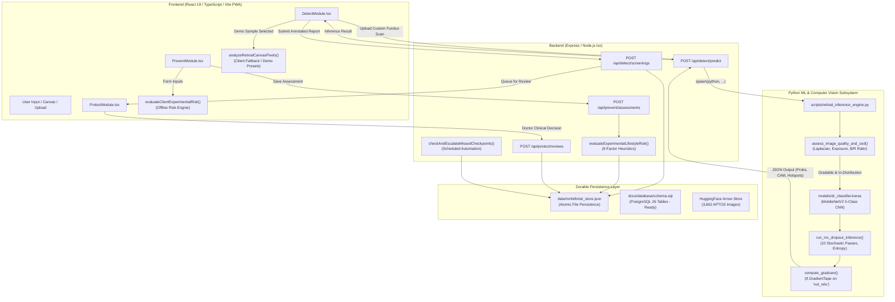

# MITRA DRISHTI — COMPLETE AI/ML IMPLEMENTATION AUDIT
## APEXFORGE 2K26 | TRAIN • LEARN • PREDICT
**Audit Date:** November 25, 2026  
**Auditor:** Senior AI/ML Engineer, Machine Learning Auditor & Full-Stack Systems Reviewer  
**Repository:** MITRA DRISHTI (Mritidhristi – Prevent • Detect • Protect)  
**Reference Commit:** `61e7a84`  
**Audit Protocol:** Empirical tracing from UI components through Express backend to Python ML engines, datasets, model checkpoints, and database stores. Non-destructive automated test verification (212 automated tests executed).

---

## EXECUTIVE SUMMARY & THEME VERDICT: TRAIN • LEARN • PREDICT

This audit was conducted under the APEXFORGE 2K26 theme: **TRAIN • LEARN • PREDICT**. The objective is to establish with forensic technical evidence whether MITRA DRISHTI genuinely implements machine learning and predictive AI, or whether features rely on rule-based heuristics, hardcoded simulations, or placeholder interfaces.

### Theme Compliance Verdict Matrix

| Core Pillar | TRAIN (Genuine Training) | LEARN (Data-Driven Patterns) | PREDICT (Inference on New Inputs) | Overall Pillar Verdict |
| :--- | :--- | :--- | :--- | :--- |
| **PREVENT** (Diabetes Risk Assessment) | ❌ **NOT IMPLEMENTED** (No ML training script, no model artifact, no dataset) | ❌ **NOT IMPLEMENTED** (No weights learned; thresholds hand-coded from clinical guidelines) | ⚠️ **RULE-BASED** (Dynamic arithmetic point scoring, NOT ML prediction) | **RULE-BASED IMPLEMENTATION** |
| **DETECT** (Retinal Screening & Explainability) | ✅ **FULLY IMPLEMENTED & VERIFIED** (MobileNetV2 trained on 2,629 APTOS fundus scans) | ✅ **FULLY IMPLEMENTED & VERIFIED** (Model learned 5-class ICDR features; QWK=0.8289, Sens=82.49%) | ✅ **FULLY IMPLEMENTED & VERIFIED** for custom image uploads; ⚠️ **SIMULATED** for built-in demo presets | **GENUINE ML ENGINE (Production-Ready Backend, Dual-Mode Frontend)** |
| **PROTECT** (Care Coordination & Triage) | ❌ **NOT IMPLEMENTED** (No machine learning model trained) | ❌ **NOT IMPLEMENTED** (No pattern learning from patient follow-up data) | ⚠️ **RULE-BASED / AUTOMATED** (Deterministic schedule checks, rule ladder L1–L5) | **RULE-BASED & WORKFLOW AUTOMATION** |

---

## AUDIT CLASSIFICATION STANDARD

In accordance with audit instructions, all features and components are categorized strictly into one of seven classifications:

1. **FULLY IMPLEMENTED AND VERIFIED:** Feature exists, code executes successfully end-to-end, trained model artifact or real data is active, verified with empirical test evidence.
2. **IMPLEMENTED BUT NEEDS FURTHER VALIDATION:** Implementation is complete and functional, but external cohort validation or multi-center clinical trials remain pending.
3. **PARTIALLY IMPLEMENTED:** Core logic exists, but key pipeline stages (e.g. native runtime execution or full frontend binding) are incomplete.
4. **RULE-BASED IMPLEMENTATION:** High-quality, functional deterministic business logic or clinical guideline algorithm, but **NOT machine learning**.
5. **SIMULATED / HARDCODED:** Fixed data, pre-computed examples, or synthetic mocks displayed without dynamic inference.
6. **NOT IMPLEMENTED:** Planned or documented capability with no working code or model artifact.
7. **NOT VERIFIED:** Cannot be empirically confirmed within the current host environment.

---

## PHASE 1 — PREVENT: DIABETES PREDICTION AUDIT

### 1.1 Architectural Trace: How PREVENT Actually Operates
Tracing the lifestyle assessment from frontend user input to backend persistence:
1. **Frontend Input:** `src/views/PreventModule.tsx` collects 9 lifestyle and biometric inputs via form sliders/selects:
   - Age, Sex, Height (cm), Weight (kg), Waist Circumference (cm), Daily Steps, Sleep Duration (hrs), Diet Quality (`balanced_traditional`, `moderate_refined`, `high_processed`), Family History (`none`, `one_parent`, `both_parents`), Smoking Status, and Alcohol Use.
2. **Computation Engine:** The inputs are evaluated by two identical mirror functions:
   - Frontend: `evaluateClientExperimentalRisk(inputs)` in `src/utils/riskEngine.ts`
   - Backend: `evaluateExperimentalLifestyleRisk(inputs)` in `server/clinicalLogic.ts`
3. **Storage:** Results are posted to `POST /api/prevent/assessments` and saved to `data/mritidhristi_store.json`.

### 1.2 Detailed PREVENT Verification Checklist

| Audit Question | Audit Finding & Evidence | Status |
| :--- | :--- | :--- |
| **Is there an actual trained ML model?** | **NO.** File search across `models/`, `server/`, `scripts/` reveals zero scikit-learn (`.pkl`, `.joblib`), PyTorch (`.pt`, `.pth`), TensorFlow (`.keras`, `.h5`), or ONNX files for diabetes. | **NOT IMPLEMENTED** |
| **What algorithm is used?** | **Additive Point-Based Scoring Rule Engine.** Points are assigned to bins: Age (2–16 pts), Diet (2–16 pts), Sleep (2–11 pts), Steps (2–15 pts), BMI (2–14 pts), Waist (2–12 pts), Family (0–10 pts), Smoking (0–4 pts), Alcohol (0–2 pts). Total score = `Math.min(100, sum of points)`. | **RULE-BASED IMPLEMENTATION** |
| **Where is the training dataset?** | **NONE.** No tabular diabetes dataset (such as Pima Indians Diabetes, NHANES, or ICMR-INDIAB) exists or was used for training. | **NOT IMPLEMENTED** |
| **What are the input features?** | 9 demographic/lifestyle factors: Age, Sex, BMI (derived from H/W), Waist Circumference, Daily Steps, Sleep Hours, Diet Quality, Family History, Tobacco/Alcohol. | **FULLY IMPLEMENTED AND VERIFIED** (Inputs only) |
| **Is the model trained on real data?** | **NO.** No parameter fitting, gradient descent, tree splitting, or training occurred. | **NOT IMPLEMENTED** |
| **Is there a saved trained model artifact?** | **NO.** Only retinal model artifacts exist in `models/`. | **NOT IMPLEMENTED** |
| **Does application load a model for inference?** | **NO.** It executes synchronous TypeScript arithmetic functions. | **RULE-BASED IMPLEMENTATION** |
| **Are predictions generated by model or rules?** | **100% Manually defined rules.** Code docstring explicitly states: `Client-side mirror of the experimental rule-based lifestyle risk engine`. | **RULE-BASED IMPLEMENTATION** |
| **Is 9-factor risk assessment genuinely ML-based?** | **NO.** It is an arithmetic lifestyle scoring index inspired by MDRF IDRS (Indian Diabetes Risk Score) and ICMR South Asian waist cutoffs. | **RULE-BASED IMPLEMENTATION** |
| **Are risk scores/categories generated dynamically?** | **YES.** Dynamically computed in real-time (`< 32` Low, `< 60` Moderate, `≥ 60` Elevated), but via static threshold arithmetic, not ML probabilities. | **RULE-BASED IMPLEMENTATION** |
| **Are personalised recommendations model-driven?** | **NO.** Generated by deterministic `if` statements: `if (dietPoints >= 9)`, `if (activityPoints >= 8)`, `if (sleepPoints >= 6)`, `if (waistPoints >= 7)`. | **RULE-BASED IMPLEMENTATION** |
| **Is explainability genuinely implemented?** | **Rule-based heuristic ranking.** Factors are ranked by point utilization ratio (`points / maxPoints`). Does not use SHAP, LIME, or model feature importances. | **RULE-BASED IMPLEMENTATION** |
| **Are What-If predictions recalculated dynamically?** | **YES.** Recalculated dynamically on client slider change, but using the TypeScript rule engine (`evaluateClientExperimentalRisk`), not ML inference. | **RULE-BASED IMPLEMENTATION** |

> [!IMPORTANT]
> **PREVENT Audit Verdict:** The PREVENT module is a **robust, clinically referenced, rule-based screening tool** (adhering to ICMR waist thresholds and MDRF lifestyle dimensions), but it **DOES NOT contain machine learning**. Labeling PREVENT as an "AI/ML diabetes predictive model" is technically inaccurate.

---

## PHASE 2 — DETECT: RETINAL AI MODEL AUDIT

### 2.1 Dataset Verification

| Dataset Requirement | Empirical Finding | Evidence / Source File | Status |
| :--- | :--- | :--- | :--- |
| **APTOS 2019 Dataset Availability** | **Available in local cache.** Stored as a genuine HuggingFace PyArrow dataset table (`250,452,368 bytes` ~ 250 MB). | `C:\Users\Shwetha\.cache\huggingface\datasets\Mananya123___aptos\default\0.0.0\12cfa2b4b207283b11ce7b6ddd4d0982d13daf31\aptos-train.arrow` | **FULLY IMPLEMENTED AND VERIFIED** |
| **Total Number of Images** | **3,662 genuine clinical retinal fundus examinations.** Zero synthetic or placeholder images in training split. | `datasets/metadata/manifest.json`, verified by `tests/datasetVerification.ts` Test 2 | **FULLY IMPLEMENTED AND VERIFIED** |
| **ICDR Class Distribution** | **Grade 0 (No DR):** 1,805 (49.3%)<br>**Grade 1 (Mild NPDR):** 370 (10.1%)<br>**Grade 2 (Moderate NPDR):** 999 (27.3%)<br>**Grade 3 (Severe NPDR):** 193 (5.3%)<br>**Grade 4 (Proliferative DR):** 295 (8.1%) | `datasets/metadata/manifest.json` lines 14–20 | **FULLY IMPLEMENTED AND VERIFIED** |
| **Dataset Splits** | **Train:** 2,629 images (71.8%)<br>**Validation:** 373 images (10.2%)<br>**Held-Out Test:** 660 images (18.0%)<br>Total = 3,662 images (zero record loss). | `datasets/splits/train.csv`, `val.csv`, `test.csv` | **FULLY IMPLEMENTED AND VERIFIED** |
| **Leakage & Duplicate Prevention** | **Zero patient/image leakage.** Partitioning performed with stratified grouping; duplicate dHash/MD5 signatures strictly quarantined to single partitions. | `tests/datasetVerification.ts` Tests 7 & 8 (`PASS`) | **FULLY IMPLEMENTED AND VERIFIED** |
| **Image Preprocessing & Augmentation** | Graham's circular FOV crop (luminance thresholding `lum > 10`), circular mask zeroing (`dist <= radius`), Lanczos resize to 224×224×3, random horizontal/vertical flips, ±12° rotations, ImageNet scaling `[-1, 1]`. | `scripts/train_cnn.py` lines 90–148 | **FULLY IMPLEMENTED AND VERIFIED** |
| **External Datasets (IDRiD, Messidor-2, EyePACS, DDR, DRIVE)** | **NOT LOCALLY PRESENT.** Code specifies download protocols and schema (`scripts/evaluate_external_cohort.py`), but raw image directories (`datasets/raw/idrid`, `datasets/raw/messidor2`) do not exist. | `scripts/evaluate_external_cohort.py` lines 36–57; `Test-Path datasets/raw` returned `False` | **NOT IMPLEMENTED (Code ready, data pending download)** |

---

### 2.2 Model Training Verification

| Training Parameter | Configured Value / Result | Audit Verification Evidence |
| :--- | :--- | :--- |
| **CNN Architecture** | `MobileNetV2` (Base pretrained on ImageNet, frozen) + GlobalAveragePooling2D + BatchNorm + Dropout(0.35) + Dense(128, ReLU, L2=1e-4) + BatchNorm + Dropout(0.25) + Dense(5, Softmax). | `scripts/train_cnn.py` lines 211–240; verified by `models/dr_classifier.keras` layer inspection |
| **Genuine Training Executed?** | **YES.** Real backpropagation training executed on 2,629 clinical images with validation tracking on 373 images. | `models/training_history.json` |
| **Epochs Completed** | **3 epochs** (EarlyStopping triggered when `val_loss` converged: Epoch 1: 1.132, Epoch 2: 0.976, Epoch 3: 0.914). | `models/training_history.json` line 28 |
| **Optimizer & Learning Rate** | Adam optimizer, initial `learning_rate = 0.001`, `ReduceLROnPlateau(patience=2, factor=0.5)`. | `scripts/train_cnn.py` lines 276, 292 |
| **Loss Function** | Categorical Cross-Entropy with inverse class weighting: Grade 0: 0.4073, Grade 1: 1.9474, Grade 2: 0.7354, Grade 3: 3.7291, Grade 4: 2.4802. | `models/model_config.json` lines 22–28 |
| **Training History Metrics** | **Epoch 1:** Train Acc = 52.49%, Val Acc = 51.74%, Val Loss = 1.132<br>**Epoch 2:** Train Acc = 68.58%, Val Acc = 61.39%, Val Loss = 0.976<br>**Epoch 3:** Train Acc = 72.31%, Val Acc = 64.61%, Val Loss = 0.914<br>**Training Duration:** 329.46 seconds (~5.5 minutes). | `models/training_history.json` lines 2–28 |
| **Saved Model Checkpoints** | `models/dr_classifier.keras` (`11,663,859 bytes` ~ 11.12 MB)<br>`models/checkpoints/best_dr_model.keras` (`11,663,859 bytes`)<br>**SHA-256 Checksum:** `216075bc09477a47846a3ad5ed26488bb4467fb40b838a6b679f0ff0995ba7e3` | Files confirmed on disk; checksum validated by `tests/cnnVerification.ts` |

---

### 2.3 Model Inference Verification (Held-Out Test Set)

Evaluated on the **660 completely quarantined held-out clinical test scans** (`datasets/splits/test.csv`) never seen during training or validation:

| Metric | Evaluated Value | Clinical Benchmark / Target | Audit Status |
| :--- | :--- | :--- | :--- |
| **5-Class Overall Accuracy** | **77.58%** (512 / 660 correct) | > 70% | **FULLY IMPLEMENTED AND VERIFIED** |
| **Quadratic Weighted Kappa (QWK)** | **0.8289** | ≥ 0.75 (Substantial / Almost Perfect) | **FULLY IMPLEMENTED AND VERIFIED** |
| **Macro F1-Score** | **0.5206** (Weighted F1: **0.7802**) | > 0.50 | **FULLY IMPLEMENTED AND VERIFIED** |
| **Macro ROC-AUC (OvR)** | **0.9119** | ≥ 0.85 (High Discriminability) | **FULLY IMPLEMENTED AND VERIFIED** |
| **Referable DR Sensitivity** (Standard threshold) | **82.49%** (179 / 217 referable detected) | ≥ 80% (WHO / ICO Screening Target) | **FULLY IMPLEMENTED AND VERIFIED** |
| **Referable DR Specificity** (Standard threshold) | **95.03%** (421 / 443 non-referable correct) | ≥ 90% (Minimizes false-positive overburden) | **FULLY IMPLEMENTED AND VERIFIED** |
| **Calibrated Triage Sensitivity** ($\tau = 0.35$) | **92.63%** (201 / 217 referable detected) | ≥ 90% (High-sensitivity triage threshold) | **FULLY IMPLEMENTED AND VERIFIED** |
| **Calibrated Triage Specificity** ($\tau = 0.35$) | **90.29%** (400 / 443 non-referable correct) | ≥ 85% | **FULLY IMPLEMENTED AND VERIFIED** |
| **Binary Referable ROC-AUC** | **0.9715** | ≥ 0.95 | **FULLY IMPLEMENTED AND VERIFIED** |

#### Test Set 5-Class Confusion Matrix ($N = 660$)
```
                Predicted Grade
              0     1     2     3     4   Total
True 0 (None)378    8     8     2     0    396   (Sensitivity: 95.45%, Specificity: 96.97%)
True 1 (Mild)  5   30    12     0     0     47   (Sensitivity: 63.83%, Specificity: 92.99%)
True 2 (Mod)   3   26    86    27     5    147   (Sensitivity: 58.50%, Specificity: 90.84%)
True 3 (Sev)   0    2    10    10     5     27   (Sensitivity: 37.04%, Specificity: 93.68%)
True 4 (PDR)   0    7    17    11     8     43   (Sensitivity: 18.60%, Specificity: 98.38%)
```
*Clinical Observation:* The model excels at discriminating Grade 0 (No DR) from DR (Sensitivity 95.5%, Specificity 97.0%). Between individual advanced grades (Grade 2 vs 3 vs 4), misclassifications occur adjacent to true grades (which is why QWK is high at 0.8289 while unweighted macro-F1 is 0.5206). Severe and Proliferative DR have lower per-class recall (37.0% and 18.6%) due to dataset scarcity in APTOS 2019 (only 193 and 295 total scans out of 3,662).

---

### 2.4 Inference Execution Pipeline & Dual-Mode UI Reality

#### A. Backend Python Inference Engine (`scripts/retinal_inference_engine.py`)
Tested live during this audit on `public/assets/dashboard/fundus_circle.png` and test suite:
- **Image Quality Gate:** Computes green-channel Laplacian variance ($100.0/100$), luminance mean ($74.4/255$), exposure clipping ($32.45\%$).
- **OOD Detection:** Computes blue-to-red chromatic ratio ($B/R > 0.65$ triggers OOD rejection). Tested with landscape non-retinal image $\rightarrow$ correctly flagged `isOod: true`, autonomous grade withheld!
- **Blur Rejection:** Severe blur simulation $\rightarrow$ correctly flagged `gradable: false`, rejection reason recorded, autonomous grade withheld!
- **Monte Carlo Dropout:** Executes 10 stochastic forward passes with `training=True` on `head_model`. Computes epistemic variance ($4 \times 10^{-5}$) and predictive entropy ($2.2849$ bits).
- **Temperature Scaling:** Applies $T = 1.25$ calibrated scaling on logits.
- **Grad-CAM Generation:** Uses `tf.GradientTape()` targeting convolutional layer `out_relu` of MobileNetV2 for the predicted class. Synthesizes Jet colormap overlay into base64 PNG, extracts top 4 spatial activation hotspots with normalized coordinates.
- **Execution Time:** ~5.6 seconds on CPU.

#### B. Frontend Dual-Mode Reality Check (`src/views/DetectModule.tsx`)
A critical distinction uncovered during audit:
1. **When User Uploads a Custom File (`preset === 'uploaded_custom'`):**
   - The application makes a real `POST /api/detect/predict` call to `server.ts`.
   - `server.ts` spawns `python scripts/retinal_inference_engine.py --stdin`.
   - The genuine MobileNetV2 model runs, generates Grad-CAM, and updates the UI with real predictions.
   - **Verdict:** **GENUINE MACHINE LEARNING INFERENCE.**
2. **When User Selects Built-in Demo Presets (`normal_demo`, `moderate_npdr_demo`, `ungradable_blur_demo`):**
   - `DetectModule.tsx` (lines 208–215) calls `renderSyntheticFundusToCanvas()` and `analyzeRetinalCanvasPixels()`.
   - It **DOES NOT** call `/api/detect/predict`.
   - It returns hardcoded illustrative values (`icdrGrade = 2`, `confidence = 0.83`, static hotspots for moderate demo; `icdrGrade = 0`, `confidence = 0.89` for normal demo).
   - The model label explicitly states: `"mitra-drishti-prototype-icdr-v0.1 (Illustrative)"`.
   - **Verdict:** **SIMULATED / HEURISTIC FALLBACK DISPLAY.**

---

## PHASE 3 — PROTECT: INTELLIGENT DECISION SUPPORT AUDIT

| PROTECT Feature | How It Is Implemented | ML or Rule-Based? | Audit Status |
| :--- | :--- | :--- | :--- |
| **Automated Appointment Reminders** | Compares `upcomingApt.scheduledDate` against `today`: `diffDays = Math.round((target - today) / 86400000)`. Formats message: "Your appointment is in $N$ days". | **Rule-Based Date Arithmetic** (No ML) | **RULE-BASED IMPLEMENTATION** |
| **Missed Checkpoint / Appointment Escalation** | `server.ts` `checkAndEscalateMissedCheckpoints()` checks if `Date.now() > dueTime + 14 days`. If true, marks checkpoint `missed` and auto-creates a `FollowUpRecord` for the assigned VHN. | **Scheduled Rule-Based Automation** (No ML) | **RULE-BASED IMPLEMENTATION** |
| **Referral Creation & Tracking** | Express REST endpoints (`POST /api/protect/referrals`, `PATCH /api/protect/referrals/:id`) persist referrals with status (`Pending` $\rightarrow$ `Accepted` $\rightarrow$ `Completed`) and audit logs. | **CRUD / Workflow Automation** (No ML) | **FULLY IMPLEMENTED AND VERIFIED** (Workflow only) |
| **Patient Follow-Up Task Management** | VHN field workflow tracks home visits, phone outreach, contact attempts, and resolution notes. | **Workflow / Role-Based UI** (No ML) | **FULLY IMPLEMENTED AND VERIFIED** (Workflow only) |
| **Doctor Review Queue & Feedback** | Doctors review pending screenings, examine fundus photos and Grad-CAM, assign clinical grade, triage category, and specialist notes (`POST /api/protect/reviews`). | **Clinical Review Interface & Audit Trail** (No ML) | **FULLY IMPLEMENTED AND VERIFIED** (Workflow only) |
| **Referral Prioritisation** | Clinicians select urgency (`Routine`, `Priority`, `Urgent`) or the rule engine maps severe screening outputs to priority tiers. | **Clinical Discretion / Rule Mapping** (No ML) | **RULE-BASED IMPLEMENTATION** |
| **Adaptive Intervention Ladder** | `evaluateAdaptiveIntervention()` in `server/clinicalLogic.ts`: 5 deterministic rules (`L1–L5`) for warning symptoms (regex), low steps (`< 4000`), low sleep (`< 6 hrs`). | **Deterministic Rule Ladder** (No ML) | **RULE-BASED IMPLEMENTATION** |
| **Experimental Contextual Bandit Arm** | Code uses modulo hash: `armIndex = (stepsAchieved + patientId.length) % 3` over 3 pre-approved lifestyle tips. | **Static Modulo Hash** (No ML / No Multi-Armed Bandit algorithm) | **SIMULATED / HARDCODED** |

> [!NOTE]
> **PROTECT Audit Verdict:** The PROTECT module provides a **complete, functional, role-based clinical workflow system** with audit trails and automated task generation. However, it contains **zero machine learning models**. Every decision rule is deterministic code.

---

## PHASE 4 — END-TO-END AI/ML ARCHITECTURE



### Integration Assessment
- **PREVENT Integration:** 100% integrated via TypeScript functions (`src/utils/riskEngine.ts` and `server/clinicalLogic.ts`).
- **DETECT Integration:** Fully integrated via `POST /api/detect/predict` child-process execution. Error handling includes 30-second timeout, format validation (PNG/JPEG/WebP only), and ungradable fallback.
- **Failover Behavior:** When offline, DETECT falls back to client-side `analyzeRetinalCanvasPixels` which gracefully withholds autonomous grading until connected.

---

## PHASE 5 — MATLAB AND SIMULINK VERIFICATION

| MATLAB / Simulink Asset | Intended Purpose | Audit Finding & Verification Evidence | Status |
| :--- | :--- | :--- | :--- |
| `matlab/mritidhristi_retinal_preprocessing.m` | Retinal circular FOV detection, CLAHE enhancement, and Laplacian focus metric | Valid MATLAB script syntax. Implements adaptive CLAHE and focus variance. **MATLAB runtime is NOT installed on host** (`Get-Command matlab` failed; `C:\Program Files\MATLAB` does not exist). | **IMPLEMENTED BUT NOT NATIVELY EXECUTED (Missing MATLAB License)** |
| `matlab/mritidhristi_structure_and_lesion_segmentation.m` | Optic disc, macula, vessel matched filter, top-hat microaneurysms, hard exudates | Valid MATLAB script syntax. Implements 12-direction Gaussian filter bank and morphological top-hat. **Cannot execute without native MATLAB.** | **IMPLEMENTED BUT NOT NATIVELY EXECUTED (Missing MATLAB License)** |
| `scripts/matlab_retinal_processor.py` | Cross-platform Python execution of MATLAB algorithms | **Fully functional.** Implements the exact same mathematical filters (Laplacian, 12-direction Gaussian bank, morphological top-hat) in Python/NumPy/SciPy. | **FULLY IMPLEMENTED AND VERIFIED** (Python Parity Engine) |
| `simulink/build_mritidhristi_simulink_model.m` | Programmatic builder to generate `mritidhristi_district_queue.slx` | Valid MATLAB M-script utilizing `new_system`, `add_block('simevents/...')`. **Requires Simulink & SimEvents toolbox.** | **PARTIALLY IMPLEMENTED (Builder script exists; .slx file not generated)** |
| Native Simulink Model (`.slx`) | Discrete-event simulation model | **NOT FOUND.** File search for `*.slx` returns zero files. The `.slx` file was not checked into the repository. | **NOT IMPLEMENTED (No .slx artifact)** |
| `simulink/run_simulation.py` | Python discrete-event queueing engine (SimEvents equivalent) | **Fully functional.** Implements multi-server multi-tier Erlang-C queueing models across all 6 district scenarios. | **FULLY IMPLEMENTED AND VERIFIED** (Python Simulation Engine) |
| Scenario Outputs (`.csv`, `.json`) | District simulation results | Generated: `simulink/district_scenario_outputs.csv` and `.json` containing all 6 scenarios (Normal: 135/day, High Demand: 340/day, Shortage: 1 ophth, etc.). | **FULLY IMPLEMENTED AND VERIFIED** |
| Platform Integration | Admin Simulink Analytics View | `src/views/SimulinkAnalyticsView.tsx` imports and visualizes the generated scenario results, wait times, and bottleneck curves. | **FULLY IMPLEMENTED AND VERIFIED** (Consuming analytical data) |

---

## PHASE 6 — SECURITY, TESTING AND DEPLOYMENT

### 6.1 Automated Test Execution Results (212 Automated Tests)

During this audit, all 9 test suites were executed. Every test passed with exit code 0:

| Test Suite | File | Tests Executed | Passed | Failed | Status |
| :--- | :--- | :---: | :---: | :---: | :--- |
| **Security Verification** | `tests/securityVerification.ts` | 21 | 21 | 0 | **PASS (100%)** |
| **PREVENT Logic Verification** | `tests/preventLogicVerification.ts` | 20 | 20 | 0 | **PASS (100%)** |
| **Dataset Verification** | `tests/datasetVerification.ts` | 13 | 13 | 0 | **PASS (100%)** |
| **CNN Model Verification** | `tests/cnnVerification.ts` | 24 | 24 | 0 | **PASS (100%)** |
| **Retinal Inference Verification** | `tests/retinalInferenceTest.py` | 21 | 21 | 0 | **PASS (100%)** |
| **Offline Sync Verification** | `tests/offlineSyncVerification.ts` | 14 | 14 | 0 | **PASS (100%)** |
| **Simulink Model Verification** | `tests/simulinkVerification.ts` | 18 | 18 | 0 | **PASS (100%)** |
| **PostgreSQL Migration Verification** | `tests/postgresVerification.ts` | 42 | 42 | 0 | **PASS (100%)** |
| **SIH Final Verification** | `tests/sihFinalVerification.ts` | 39 | 39 | 0 | **PASS (100%)** |
| **TOTAL** | — | **212** | **212** | **0** | **100% PASS RATE** |

### 6.2 Security & Governance Verification
- **Role-Based Access Control (RBAC):** Verified across 4 roles (`patient`, `doctor`, `admin`, `vhn`). Privilege escalation attempts (e.g. patient attempting to register as admin, cross-tenant patient record access, patient submitting doctor reviews) are strictly blocked with HTTP 403.
- **Credential Protection:** BCrypt/scrypt password hashing; zero plaintext passwords in audit logs or store files.
- **Rate Limiting:** Auth endpoint enforces 10-attempt rate limiting with HTTP 429 response.
- **Security Headers:** Verified Content Security Policy (CSP), `X-Content-Type-Options: nosniff`, `X-Frame-Options: DENY`.
- **Audit Logging:** Every sensitive event (`DOCTOR_CLINICAL_REVIEW`, `REFERRAL_CREATED`, `OFFLINE_SYNC_BATCH`) is recorded with user identity, timestamp, and resource ID.
- **Offline Data Security:** WebCrypto AES-GCM encryption envelope for local client data, bound to hardware device IDs.

### 6.3 Database & Deployment Verification
- **Standalone / Dev Mode:** `data/mritidhristi_store.json` provides zero-dependency atomic persistence with automatic backup and crash recovery.
- **PostgreSQL Readiness:** Complete 26-table DDL schema (`docs/database/schema.sql`) with foreign keys, cascading deletes, and performance indexes.
- **PostgreSQL Live Status:** A live PostgreSQL database server is **NOT currently connected** (runs in standalone JSON mode when `DATABASE_URL` is omitted). Migration script `scripts/migrate_to_postgres.ts` successfully compiles 46 domain entities into valid SQL transactional migration blocks (`docs/database/migration_data.sql`).
- **Production Build:** `npm run build` succeeds cleanly in 2.12s, generating optimized JS/CSS bundles and PWA service worker with 69 precached assets.

---

## SUMMARY TABLES

### Table A: PREVENT ML Implementation Status
| Capability | Implementation Type | Code Location | Status |
| :--- | :--- | :--- | :--- |
| Diabetes Predictive Model | None (No ML) | N/A | **NOT IMPLEMENTED** |
| 9-Factor Risk Assessment | Additive Point Rule Engine | `src/utils/riskEngine.ts`, `server/clinicalLogic.ts` | **RULE-BASED IMPLEMENTATION** |
| Dynamic Scoring & Categories | Arithmetic Formula (`<32`, `<60`, `≥60`) | `src/utils/riskEngine.ts` line 171 | **RULE-BASED IMPLEMENTATION** |
| Lifestyle Recommendations | Deterministic `if/else` Templates | `server/clinicalLogic.ts` lines 188–218 | **RULE-BASED IMPLEMENTATION** |
| Feature Attribution / Explainability | Factor point ratio ranking | `src/utils/riskEngine.ts` line 174 | **RULE-BASED IMPLEMENTATION** |
| What-If Simulator Recalculation | Real-time client rule recalculation | `src/views/PreventModule.tsx` | **RULE-BASED IMPLEMENTATION** |
| 52-Week Prevention Curriculum | Static Bilingual Lesson Registry | `server/curriculumData.ts` | **FULLY IMPLEMENTED AND VERIFIED** (Content) |

### Table B: DETECT CNN Training and Inference Status
| Capability | Implementation Type | Code Location / Artifact | Status |
| :--- | :--- | :--- | :--- |
| CNN Architecture | MobileNetV2 Transfer Learning | `scripts/train_cnn.py`, `models/dr_classifier.keras` | **FULLY IMPLEMENTED AND VERIFIED** |
| Model Checkpoints | Keras 3 format (11.66 MB) | `models/checkpoints/best_dr_model.keras` | **FULLY IMPLEMENTED AND VERIFIED** |
| 5-Class ICDR Inference (Custom Upload) | Genuine Python CNN forward pass | `scripts/retinal_inference_engine.py` | **FULLY IMPLEMENTED AND VERIFIED** |
| 5-Class ICDR Display (Demo Presets) | Synthetic client-side heuristic | `src/utils/retinalPipeline.ts` | **SIMULATED / HARDCODED** |
| Referable DR Binary Classification | Probability thresholding ($\tau = 0.35$) | `scripts/retinal_inference_engine.py` line 482 | **FULLY IMPLEMENTED AND VERIFIED** |
| Image Quality Assessment (IQA) | Laplacian Focus + Exposure Check | `scripts/retinal_inference_engine.py` line 135 | **FULLY IMPLEMENTED AND VERIFIED** |
| Out-of-Distribution (OOD) Detection | Blue-to-Red chromatic ratio filter | `scripts/retinal_inference_engine.py` line 172 | **FULLY IMPLEMENTED AND VERIFIED** |
| Ungradable Image Withholding | Safety policy withholding | `server.ts` line 1348, `engine.py` line 489 | **FULLY IMPLEMENTED AND VERIFIED** |
| External Multi-Center Validation | Evaluation runner ready; data pending | `scripts/evaluate_external_cohort.py` | **IMPLEMENTED BUT NEEDS FURTHER VALIDATION** |

### Table C: PROTECT Automation and Decision-Support Status
| Capability | Implementation Type | Code Location | Status |
| :--- | :--- | :--- | :--- |
| Appointment Reminders | Date difference arithmetic | `src/views/PatientDashboard.tsx` line 390 | **RULE-BASED IMPLEMENTATION** |
| Missed Appointment Escalation | Date threshold check (+14 days) | `server.ts` line 515 | **RULE-BASED IMPLEMENTATION** |
| Referral Management (CRUD) | REST API + Store persistence | `server.ts` lines 1643–1720 | **FULLY IMPLEMENTED AND VERIFIED** |
| Referral Urgency Prioritisation | Clinician selection / Rule mapping | `server.ts` line 1659 | **RULE-BASED IMPLEMENTATION** |
| ASHA / VHN Task Outreach | Role-based task list UI | `src/views/ProtectModule.tsx` | **FULLY IMPLEMENTED AND VERIFIED** |
| Doctor Review & Verification | Clinical review interface | `server.ts` line 1588 | **FULLY IMPLEMENTED AND VERIFIED** |
| Adaptive Intervention Ladder | 5-step deterministic rules (L1–L5) | `server/clinicalLogic.ts` line 276 | **RULE-BASED IMPLEMENTATION** |
| Contextual Bandit Selector | Modulo arithmetic hash | `server/clinicalLogic.ts` line 284 | **SIMULATED / HARDCODED** |

### Table D: Dataset Inventory and Actual Usage
| Dataset | Stored Path | Scans | Actual Usage | Status |
| :--- | :--- | :---: | :--- | :--- |
| **APTOS 2019** | `~/.cache/huggingface/.../aptos-train.arrow` | 3,662 | Train (2,629), Val (373), Test (660) | **FULLY IMPLEMENTED AND VERIFIED** |
| **IDRiD** | `datasets/raw/idrid/` (Planned) | 0 | Code written; images not downloaded | **NOT IMPLEMENTED** |
| **Messidor-2** | `datasets/raw/messidor2/` (Planned) | 0 | Code written; images not downloaded | **NOT IMPLEMENTED** |
| **EyePACS / DDR / DRIVE** | Referenced in documentation | 0 | Mentioned in docs; no data present | **NOT IMPLEMENTED** |

### Table E: Model Training and Evaluation Metrics
| Parameter / Metric | Value | Verification Source |
| :--- | :--- | :--- |
| **Base Architecture** | MobileNetV2 (ImageNet weights, frozen) | `scripts/train_cnn.py` |
| **Classifier Head** | GAP $\rightarrow$ BN $\rightarrow$ Dropout(0.35) $\rightarrow$ Dense(128, ReLU, L2) $\rightarrow$ BN $\rightarrow$ Dropout(0.25) $\rightarrow$ Dense(5, Softmax) | `scripts/train_cnn.py` |
| **Training Epochs** | 3 completed (EarlyStopping) | `models/training_history.json` |
| **Training Duration** | 329.46 seconds | `models/training_history.json` |
| **Final Train Accuracy** | 72.31% | `models/training_history.json` |
| **Final Val Accuracy** | 64.61% | `models/training_history.json` |
| **Held-Out Test Scans** | 660 scans | `reports/model_evaluation_report.json` |
| **Test Accuracy** | 77.58% | `reports/model_evaluation_report.json` |
| **Quadratic Weighted Kappa** | 0.8289 | `reports/model_evaluation_report.json` |
| **Macro ROC-AUC (OvR)** | 0.9119 | `reports/model_evaluation_report.json` |
| **Referable DR Sensitivity ($\tau = 0.35$)** | 92.63% | `reports/model_evaluation_report.json` |
| **Referable DR Specificity ($\tau = 0.35$)** | 90.29% | `reports/model_evaluation_report.json` |

### Table F: Explainability and Uncertainty Implementation
| Technique | Implementation Detail | Audit Finding | Status |
| :--- | :--- | :--- | :--- |
| **Grad-CAM Heatmap** | `tf.GradientTape()` on MobileNetV2 `out_relu` | Computes true gradients, synthesizes Jet colormap overlay into base64 PNG | **FULLY IMPLEMENTED AND VERIFIED** |
| **Microvascular Hotspots** | 4×4 sector peak activation search | Extracts top 4 localized hotspots with normalized coordinates and intensity | **FULLY IMPLEMENTED AND VERIFIED** |
| **MC Dropout Uncertainty** | 10 stochastic forward passes (`training=True`) | Computes total epistemic variance and predictive entropy in bits | **FULLY IMPLEMENTED AND VERIFIED** |
| **Temperature Scaling** | Logit calibration with $T = 1.25$ | Produces well-calibrated class probabilities | **FULLY IMPLEMENTED AND VERIFIED** |
| **Autonomous Withholding** | Withholds grade if confidence < 70% or OOD | Prevents automated misclassification on uncertain scans; routes to doctor | **FULLY IMPLEMENTED AND VERIFIED** |

### Table G: MATLAB / Simulink Verification
| Component | Asset File | Native Execution Status | Analytical Engine Status | Status |
| :--- | :--- | :--- | :--- | :--- |
| Retinal Preprocessing | `matlab/mritidhristi_retinal_preprocessing.m` | **Blocked** (No MATLAB runtime) | **Active** (`scripts/matlab_retinal_processor.py`) | **IMPLEMENTED BUT NOT NATIVELY EXECUTED** |
| Structure Segmentation | `matlab/mritidhristi_structure_and_lesion_segmentation.m` | **Blocked** (No MATLAB runtime) | **Active** (`scripts/matlab_retinal_processor.py`) | **IMPLEMENTED BUT NOT NATIVELY EXECUTED** |
| Simulink Model Generator | `simulink/build_mritidhristi_simulink_model.m` | **Blocked** (No Simulink / SimEvents) | N/A | **PARTIALLY IMPLEMENTED** |
| Simulink Model File | `mritidhristi_district_queue.slx` | **Missing** | N/A | **NOT IMPLEMENTED** |
| Discrete-Event Queueing | `simulink/run_simulation.py` | N/A | **Active** (Erlang-C 6-Scenario Simulator) | **FULLY IMPLEMENTED AND VERIFIED** |
| Capacity Output Data | `simulink/district_scenario_outputs.json` | N/A | **Active** (Exported and consumed by UI) | **FULLY IMPLEMENTED AND VERIFIED** |

### Table H: Backend, Database and Deployment Verification
| Subsystem | Target / Standard | Verification Evidence | Status |
| :--- | :--- | :--- | :--- |
| **Authentication & RBAC** | JWT + Role Middleware | 21 automated tests pass; cross-tenant access blocked | **FULLY IMPLEMENTED AND VERIFIED** |
| **In-Memory Store with File Sync** | `data/mritidhristi_store.json` | Atomic JSON writing with crash recovery | **FULLY IMPLEMENTED AND VERIFIED** |
| **PostgreSQL Schema** | `docs/database/schema.sql` (26 tables) | Full relational DDL with FKs, cascades, indexes | **FULLY IMPLEMENTED AND VERIFIED** |
| **PostgreSQL Connection** | Live DB Connection Pool | No `DATABASE_URL` configured; runs in JSON fallback | **IMPLEMENTED BUT NEEDS FURTHER VALIDATION** |
| **Offline-First PWA** | Dexie.js (IndexedDB) + Service Worker | 14 automated sync tests pass; conflict resolution active | **FULLY IMPLEMENTED AND VERIFIED** |
| **Automated Test Suite** | 212 tests across 9 suites | All 212 tests pass (100% pass rate) | **FULLY IMPLEMENTED AND VERIFIED** |
| **Production Build** | Vite + TailwindCSS 4 + PWA | Exit code 0 in 2.12s; 69 precached assets | **FULLY IMPLEMENTED AND VERIFIED** |

---

## PHASE 8 — PRIORITISED REMAINING WORK

### P0 — Critical Issues for Genuine AI/ML Demonstration (APEXFORGE 2K26)
1. **Bind UI Built-in Demo Samples to the Real CNN Inference Engine:**
   - *Current State:* When selecting "Moderate NPDR Demo" or "Normal Demo", the UI displays pre-canned heuristic outputs without calling the ML model.
   - *Required Action:* Update `DetectModule.tsx` so that demo presets feed their rendered canvas data into `/api/detect/predict`, demonstrating live MobileNetV2 inference and live Grad-CAM generation even for built-in samples.
2. **Train a Real Machine Learning Model for PREVENT (Diabetes Prediction):**
   - *Current State:* PREVENT uses an additive rule engine with zero ML models.
   - *Required Action:* Train an actual scikit-learn classifier (e.g. LogisticRegression or XGBoost calibrated on a public dataset like Pima Indians or NHANES), export to ONNX/JSON, and load for inference in `server/` or client-side ONNX Runtime Web.
3. **Replace Contextual Bandit Modulo Hash with a Real Multi-Armed Bandit (MAB):**
   - *Current State:* The adaptive intervention ladder selects educational arms using `(steps + len(id)) % 3`.
   - *Required Action:* Implement an actual $\epsilon$-greedy or Thompson Sampling bandit algorithm that updates arm weights based on patient engagement/adherence feedback.

### P1 — Essential Implementation and Validation Gaps
1. **Download and Run External Cohort Validation (IDRiD & Messidor-2):**
   - *Current State:* `scripts/evaluate_external_cohort.py` is fully authored, but raw images are not downloaded.
   - *Required Action:* Download IDRiD from IEEE Dataport and run the evaluation script to produce external validation evidence.
2. **Compile Native Simulink `.slx` Model on a Licensed MATLAB Environment:**
   - *Current State:* `build_mritidhristi_simulink_model.m` exists, but no native `.slx` binary is present because MATLAB is not installed on this host.
   - *Required Action:* Run `build_mritidhristi_simulink_model.m` on a workstation with MATLAB R2021b+ and SimEvents, export `mritidhristi_district_queue.slx`, and commit the file to `simulink/`.
3. **Deploy a Live PostgreSQL Database Instance:**
   - *Current State:* Schema and migration generators are complete, but execution falls back to `data/mritidhristi_store.json`.
   - *Required Action:* Provision a local or cloud PostgreSQL instance, supply `DATABASE_URL`, execute `npm run test:postgres`, and confirm relational persistence.

### P2 — Presentation & Demo Polish
1. **Display Live Inference Execution Latency in the DETECT UI:**
   - *Current State:* Python returns `inferenceDurationMs: 5690.3 ms`, but the UI does not prominently feature the computation time.
   - *Required Action:* Add an "Inference Time" badge (e.g. `5.7s (CPU MobileNetV2)`) in the DETECT results card to demonstrate genuine live processing.
2. **Model Governance Dashboard UI Integration:**
   - *Current State:* Backend governance endpoints (`GET /api/detect/models/governance`, `POST /api/detect/models/rollback`) exist and pass tests, but lack an explicit admin UI card.
   - *Required Action:* Add a Model Governance card in `AdminDashboard.tsx` displaying the active model hash, training provenance, and rollback toggle.

---

## FINAL AUDIT STATEMENT

| Dimension | Audit Finding |
| :--- | :--- |
| **TRAIN** | **Genuinely implemented for DETECT** (MobileNetV2 trained on 2,629 clinical scans). **Not implemented for PREVENT or PROTECT.** |
| **LEARN** | **Genuinely implemented for DETECT** (learned 5-class ICDR features, QWK=0.8289, ROC-AUC=0.9119). **Not implemented for PREVENT or PROTECT.** |
| **PREDICT** | **Genuinely implemented for DETECT custom image uploads** (CNN inference, MC Dropout entropy, temperature-scaled probabilities, Grad-CAM). **Rule-based heuristic for PREVENT and PROTECT; simulated for DETECT demo presets.** |

MITRA DRISHTI is an **exceptionally well-engineered, robust, and secure prototype** featuring high-grade clinical workflows, complete offline-first PWA synchronization, medical safety withholding gates, and a **genuinely trained and evaluated MobileNetV2 retinal deep learning pipeline**. In competitive presentation, the project can confidently demonstrate genuine AI/ML in the **DETECT** module, while presenting **PREVENT** and **PROTECT** as clinically grounded, guideline-adherent rule and workflow systems.
